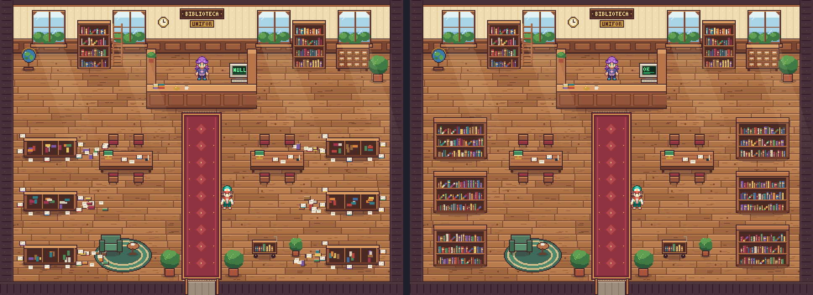

# Quest 2: a Biblioteca em pixel art



A Biblioteca deixou de ser uma sala com retângulos coloridos. Agora é pixel art em camadas,
no estilo de jogos aconchegantes de vida no campo: piso de tábuas, parede com papel listrado
e lambri, quatro janelas com o campus lá fora e raios de sol, tapete vermelho da porta até o
balcão, mesas de leitura com luminária, um cantinho com poltrona, globo, fichário, plantas e
um carrinho de devolução. Toda a arte é original e gerada por script.

## Antes e depois

- **Antes da quest** (como em `docs/story.md`): as seis estantes do salão estão tombadas,
  com livros e folhas espalhados pelo chão, e o terminal da Dona Célia pisca `NULL`.
- **Depois** (`acervo-organizado`, efeito da própria quest): quando o painel do editor fecha,
  as estantes se levantam uma a uma, cheias de livros, a bagunça some, o terminal mostra
  `OK` e aparece o aviso "ACERVO ORGANIZADO!". Em seguida, o caminho até o livro acende no
  tapete, losango por losango, do balcão até a porta. Quem volta à sala depois já a
  encontra arrumada, com o caminho aceso.

## Por que não fica mais borrado

- O cenário é desenhado em **1 pixel de arte = 1 pixel do jogo**, a mesma densidade dos
  personagens. Antes, cenários em 2× ao lado de personagens em 1× davam pixels de tamanhos
  diferentes.
- A câmera usa **zoom inteiro (2×)**. Zoom fracionado (o CC usava 1,45) faz pixels vizinhos
  saírem com tamanhos diferentes na tela, e isso parece borrão.
- O texto dentro da arte (placa, terminal) usa uma **fonte bitmap 3×5**, sem antialiasing.
- O canvas tem `image-rendering: pixelated`: ao esticar o jogo para a janela, o navegador
  não suaviza os pixels.

Decisão registrada no [ADR 0075](decisions/0075-pixel-art-na-densidade-do-personagem.md).

## Controles

Setas: andar · `E`: falar com a Dona Célia / sair pela porta · `M`: mapa da sala ·
`F3`: mostrar as colisões (QA) · `Esc`: pausa.

## Como editar

O layout, os sprites e as colisões saem de um único lugar,
`scripts/render-biblioteca-pixel-art.py` (precisa de Python 3 + Pillow só para gerar; o jogo
não usa Python):

```sh
npm run generate:biblioteca-art   # sprites, layout.json, biblioteca-assets.generated.ts, preview
npm run generate:maps             # recompila content/maps/biblioteca.tmj a partir do layout
npm run sync:map-assets           # copia para apps/game/src/renderer/public
npm run check:biblioteca-navigation
```

`check:biblioteca-navigation` percorre a sala com a caixa de pés real do jogador. Ele
confere que a Dona Célia e a porta são alcançáveis, que ninguém entra atrás do balcão e que
cada colisor no `.tmj` é exatamente a pegada do sprite desenhado ali.
