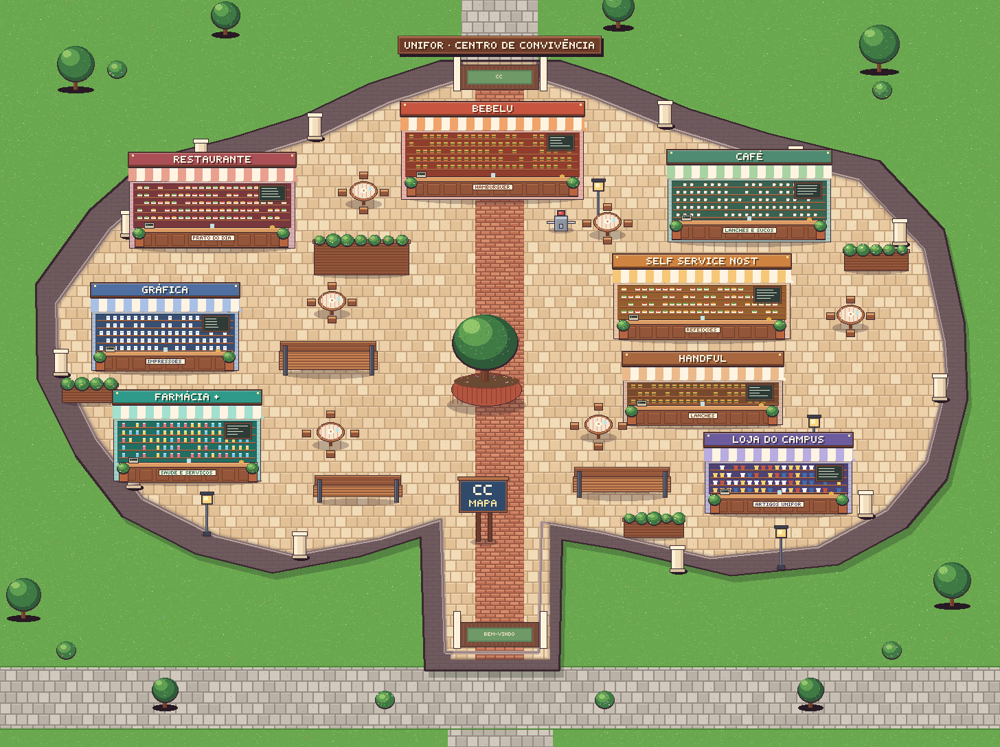

# Quest 3: o Centro de Convivência



O Centro de Convivência agora é um cenário de **pixel art em camadas**, e não uma única ilustração. A planta preserva as **duas saídas opostas**, a farmácia, o Bebelú, o Nost, o Handful e a praça de alimentação. Apenas um box usa o nome genérico “Restaurante”; os outros receberam funções distintas (café, gráfica e Loja do Campus), evitando restaurantes repetidos. O CC **não tem escada nem mezanino**.

A nova arte é uma interpretação estilizada da Unifor, não uma reprodução arquitetônica oficial. A disposição dos serviços segue o rascunho do projeto e informações gerais do Centro de Convivência. Não reproduz as fachadas atuais com exatidão.

## Como a cena é montada

- **Fonte gráfica e das colisões:** `scripts/render-cc-pixel-art.py`, que gera sprites independentes (`assets/cc/pixel-world/*.png`), `layout.json` e a constante tipada `cc-assets.generated.ts`.
- **Camada fixa:** `ground.png`, contendo piso em blocos, colunas, caminhos e os portais norte/sul.
- **Sprites com profundidade:** cada loja, mesa, banco, poste e jardim tem sprite separado ordenado pela posição Y de seus pés. O personagem pode passar atrás ou à frente desses objetos.
- **Colisão no piso:** o compilador Tiled (`content/maps/src/centro-de-convivencia.mjs`) extrai as **mesmas footprints** de `assets/cc/pixel-world/layout.json`; a arte elevada não vira barreira invisível.
- **Movimento:** deslocamento por passos pequenos (até 3 px) e resolução independente dos eixos, com deslizamento nas paredes e menor possibilidade de atravessar móveis em quedas de FPS. Sombra e efeitos discretos de caminhada.
- **Câmera:** acompanha o protagonista com **zoom inteiro 2×**, como nos RPGs 2D. A arte é desenhada em 1 pixel = 1 pixel do jogo, a mesma densidade dos personagens, então nada fica borrado ([ADR 0075](decisions/0075-pixel-art-na-densidade-do-personagem.md)).
- **Missão:** Seu Raimundo oferece a quest da fila. Ao concluir (`centro-de-convivencia-reaberto`), os estudantes se alinham, a catraca na frente da fila troca a luz vermelha pela verde (`catraca` e `catraca-ok`, gerados pelo mesmo script) e o Bloco de Tecnologia é liberado no campus. Os dois portais voltam a lados opostos do prédio no campus.

## Controles e teste

Setas: andar · `E`: interagir/sair · `M`: visão geral do CC · `F3`: mostrar/ocultar áreas reais de colisão (QA) · `Esc`: pausa.

```sh
npm run check:cc-navigation
npm run build:packages
npm run dev
```

Para **editar o layout**: altere `scripts/render-cc-pixel-art.py`, gere os sprites com `npm run generate:cc-art`, rode `npm run generate:maps` e `npm run sync:map-assets`. Os arquivos gerados não devem ser editados diretamente.
