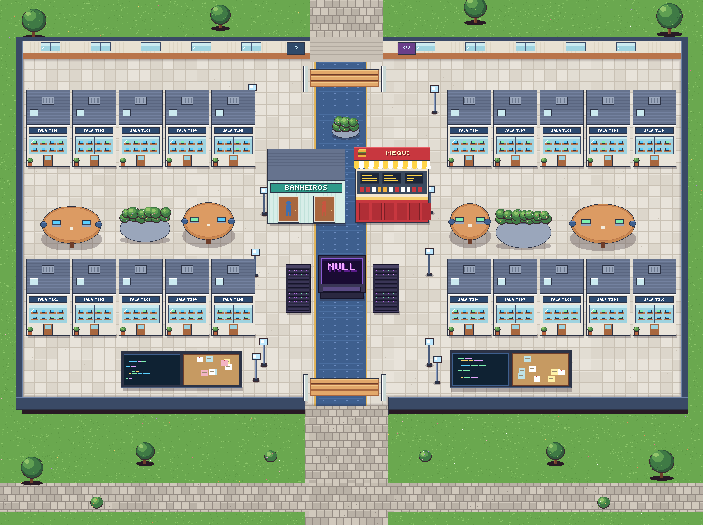

# Quest 4: o Bloco de Tecnologia



O interior do Bloco de Tecnologia, onde o calouro enfrenta o NULL (docs/story.md). É pixel
art em camadas, na mesma densidade dos personagens, com câmera de zoom inteiro 2×
([ADR 0075](decisions/0075-pixel-art-na-densidade-do-personagem.md)).

- Quatro alas de salas de aula, cinco por ala: T101 a T110 e T201 a T210. Cada sala tem
  telhado, janelas com as mesas e os monitores, e porta.
- Banheiros e o quiosque de lanches (Mequi, com um ícone próprio de hambúrguer) no centro.
- Mesas de estudo, floreiras, painéis com código e mural de recados.
- O terminal do NULL entre dois servidores, no tapete do corredor central. Quando o duelo
  termina e o painel fecha, a cutscene `final` desfaz o NULL em blocos verdes, a tela do
  terminal passa de `NULL` para `REDE OK` (`null-console-ok`), a rede é restaurada, e a
  cutscene leva o jogador ao campus, onde o Davi aparece no epílogo
  ([ADR 0076](decisions/0076-final-em-duas-cutscenes-e-creditos.md)).
- Dois pequenos lances de degraus, ao norte e ao sul, são as saídas. Não levam a outro piso.

## Controles

Setas: andar · `E`: interagir com NULL, salas, quiosque, banheiro ou saídas ·
`M`: vista geral · `F3`: mostrar as colisões (QA) · `Esc`: pausa.

## Como editar

Arte, layout e colisões saem de `scripts/render-tech-pixel-art.py` (Python 3 + Pillow, só
para gerar; o jogo não usa Python):

```sh
npm run generate:tech-art         # sprites, layout.json, tech-assets.generated.ts, preview
npm run generate:maps             # recompila content/maps/bloco-de-tecnologia.tmj
npm run sync:map-assets           # copia para apps/game/src/renderer/public
npm run check:tech-navigation
```

`check:tech-navigation` confere que o terminal e as saídas são alcançáveis e que
cada colisor do `.tmj` é exatamente a pegada do sprite desenhado ali.
